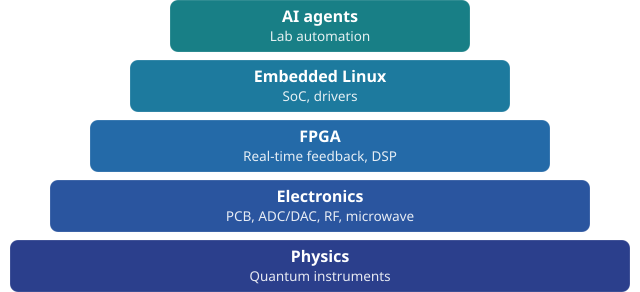

# Hi, I'm Haifei Wang 👋

I'm a Ph.D. candidate in Quantum Technologies at the Centre for Quantum Technologies, National University of Singapore. I build experimental systems from the bottom up, from the physics and the electronics to the automation that runs the experiment.

  

Right now I work on the experimental side of quantum science and technology, including single-photon sources, detector electronics and FPGA-based real-time feedback. I'm also exploring AI agents for automated scientific instrumentation.

I keep notes on physics, mathematics and engineering at **[haifei.pro](https://haifei.pro)**.

📧 [haifei_wang@u.nus.edu](mailto:haifei_wang@u.nus.edu)  
🔬 [ORCID](https://orcid.org/0009-0004-6041-3816)
