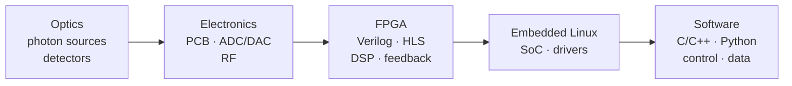

# Hi, I'm Haifei Wang 👋

I'm a Ph.D. candidate in Quantum Technologies at the Centre for Quantum Technologies, National University of Singapore. I build experimental systems end to end, from the optics and electronics up to the software that runs the experiment.

Right now I work on quantum optics hardware, including single-photon sources, detector electronics and FPGA-based real-time feedback. I'm also using AI agents to automate scientific instruments.

🌐 [haifei.pro](https://haifei.pro) · 📧 [haifei_wang@u.nus.edu](mailto:haifei_wang@u.nus.edu) · 🔬 [ORCID](https://orcid.org/0009-0004-6041-3816)
